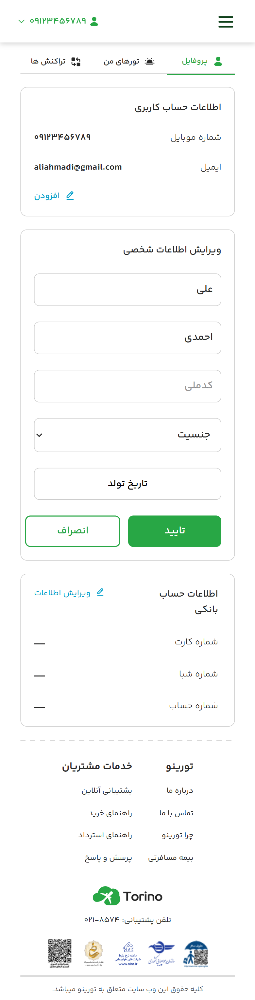

# Torino | Online Travel Booking Platform

Torino is a responsive online travel booking platform that allows users to explore domestic and international tours, search for trips, book tours, and manage their accounts.

The application is built with Next.js and provides a user-friendly interface with Persian (RTL) support.

## Screenshots

### Home


### OTP Authentication


### Profile



### My Tours


### Tour Details


## Features

- Browse domestic and international tours
- Search tours by origin, destination, and travel date
- View tour information and details
- User authentication using mobile number and OTP verification
- Manage personal account information
- Edit personal and banking information
- Add tours to the shopping basket
- Complete the booking and purchase process
- View purchased tours and transaction history
- Responsive design for desktop, tablet, and mobile devices
- Persian language and RTL layout

## Tech Stack

**Frontend**

- [Next.js 16](https://nextjs.org/)
- [React 19](https://react.dev/)
- [Tailwind CSS 4](https://tailwindcss.com/)
- [TanStack Query](https://tanstack.com/query/latest)
- [Axios](https://axios-http.com/)
- [React Hook Form](https://react-hook-form.com/)
- [Zod](https://zod.dev/)
- [React Icons](https://react-icons.github.io/react-icons/)
- [Swiper](https://swiperjs.com/)
- [React Toastify](https://fkhadra.github.io/react-toastify/)

## Project Structure

```text
torino/
├── app/                  # Application routes and layouts
├── components/           # Reusable UI components
├── core/
│   ├── config/           # Application configuration
│   ├── services/         # API services and queries
│   └── utils/            # Helper functions
├── provider/             # Application providers
├── public/               # Static assets
│   ├── fonts/
│   ├── images/
│   └── screenshots/
├── .gitignore
├── jsconfig.json
├── next.config.mjs
├── package.json
└── README.md
```

## Getting Started

### Prerequisites

- Node.js
- npm
- Torino API server

### Installation

1. Clone the repository:

```bash
git clone https://github.com/shakiba-bahrami/torino.git
```

2. Navigate to the project directory:

```bash
cd torino
```

3. Install dependencies:

```bash
npm install
```

4. Make sure the Torino API server is running and the API base URL in the project configuration points to the correct address.

5. Start the development server:

```bash
npm run dev
```

6. Open the following URL in your browser:

```text
http://localhost:3000
```

## Available Scripts

| Command         | Description                           |
| --------------- | ------------------------------------- |
| `npm run dev`   | Starts the development server         |
| `npm run build` | Builds the application for production |
| `npm run start` | Starts the production server          |

## Backend

Torino frontend communicates with a separate backend API for authentication, tour information, user profiles, basket management, and transactions.

## Author

**Shakiba Bahrami**

[GitHub Repository](https://github.com/shakiba-bahrami/torino)
